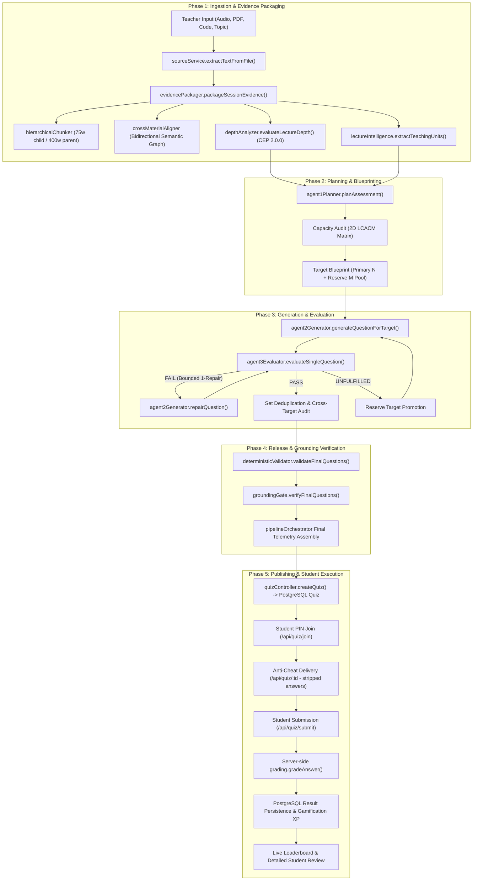

# KMIT Kahoot — Complete Pipeline Architecture & Technical Reference

**System**: KMIT Kahoot Multi-Agent Assessment Platform  
**Release Tag**: `v1.0.0-prod`  
**Baseline Commit**: `a328953f9a63fa11b48c5378cecf058414a15388`  
**Target Environment**: Node.js (v24), Express, Supabase PostgreSQL, Prisma ORM, Socket.IO, Groq/Gemini LLM APIs  
**Status**: Architecture Frozen — Documentation & Technical Reference

---

## 1. High-Level Architectural Overview

KMIT Kahoot generates, validates, publishes, and scores curriculum-aligned assessment questions directly from real classroom artifacts (audio lectures, PDF/PPT lecture slides, code repositories, or syllabus topics).

Unlike naive single-prompt LLM wrappers, KMIT Kahoot implements a **deterministic multi-agent pipeline** with strict dual-authority evidence partitioning, capacity-gated difficulty allocation, bounded repair loops, anti-cheat delivery safeguards, and cryptographic payload immutability.



---

## 2. The 16 Pipeline Execution Stages (Complete Trace)

### Stage 01: Teacher Input & Session Configuration
- **Entry Point**: `server/controllers/quizController.js` $\rightarrow$ `generateQuizTask()` or `generateVoiceQuiz()` (lines 1040–1130).
- **Inputs**: HTTP multipart payload: `req.files` (audio file, PDF/PPT slides), `req.body` (`title`, `topic`, `difficulty`, `questionCount`, `capacityPolicy`, `deficitPolicy`).
- **Processing**:
  - Validates file extensions (`.mp3`, `.wav`, `.m4a`, `.pdf`, `.pptx`, `.py`).
  - Initializes task record in in-memory task registry (`createTask(taskId, options)`).
  - Normalizes parameters into `sessionInputs`:
    ```javascript
    const sessionInputs = {
      title, topic, subject, count: parseInt(questionCount) || 6,
      difficulty: difficulty || 'Balanced',
      voiceTranscript, documentTexts, codeSnippets,
      capacityPolicy: capacityPolicy || 'ALLOW_SCOPE_SUPPLEMENTARY',
      deficitPolicy: deficitPolicy || 'FILL_WITH_MEDIUM'
    };
    ```
- **Next Stage**: Dispatches asynchronously to `pipelineOrchestrator.runPipeline(sessionInputs, progressCallback)`.
- **Database Interaction**: None (task tracked in-memory with SSE updates).
- **Error Handling**: Missing files or non-numeric counts trigger early `HTTP 400 Bad Request`.

### Stage 02: Multi-Modal Extraction & Normalization
- **Entry Point**: `server/services/sourceService.js` $\rightarrow$ `extractTextFromFile(filePath, reqId)`.
- **Inputs**: Local disk file paths from Multer storage (`server/uploads/`).
- **Processing**:
  - **PDFs**: Parsed via `pdf-parse` (preserving line structure and page markers).
  - **PowerPoint**: Parsed via `pptx-parser` (extracting slide blocks and hierarchical speaker notes).
  - **Audio**: Transcribed via Fast Whisper / Google Speech API (`sourceService.transcribeAudio()`).
  - Cached in `cacheManager` with LRU eviction to prevent repeated file reading.
- **Output**: Raw UTF-8 text strings: `voiceTranscript`, `documentTexts[]`, `codeSnippets`.
- **Next Stage**: Passed to `pipelineOrchestrator.js` Stage 02.
- **Error Handling**: Empty extracted text ($< 10$ characters) throws `EMPTY_EXTRACTION_SOURCE`.

### Stage 03: Content Unification & Evidence Packaging
- **Entry Point**: `server/engine/evidence/evidencePackager.js` $\rightarrow$ `packageSessionEvidence(sessionInputs)`.
- **Inputs**: `sessionInputs` containing multi-modal raw strings.
- **Processing**:
  - **Dual-Source Authority Division**: Voice transcript establishes instructional intent, emphasis, and student misconceptions; documents/code supply exact equations, syntax, and variable names.
  - **Hierarchical Chunking**: `hierarchicalChunker.js` generates dual-level RAG nodes:
    - 75-word child chunks (micro-citations for answer justification).
    - 400-word parent windows (macro-context for distractor generation).
  - **Cross-Material Alignment**: `crossMaterialAligner.js` constructs a bidirectional graph linking spoken timestamps to specific slide page numbers.
  - **PDI Router**: Classifies presentation modality into `UNIFIED`, `BLUEPRINT`, or `SUMMARY`.
- **Output**: `evidencePackage` object containing `hierarchicalStore`, `alignmentGraph`, `voiceEmphasis`, `artifacts`.
- **Next Stage**: Stage 04 (Pedagogical Teaching-Unit Extraction).
- **Error Handling**: If `evidencePackage.isAcademic === false`, throws controlled `NON_ACADEMIC_CONTENT` and halts.

### Stage 04: Teaching-Unit & Concept Analysis
- **Entry Point**: `server/engine/intelligence/lectureIntelligence.js` $\rightarrow$ `extractTeachingUnits(options)`.
- **Inputs**: `voiceTranscript`, `documentTexts`, `hierarchicalStore`, `alignmentGraph`.
- **Processing**:
  - Splits lecture into 10-minute overlapping temporal windows.
  - Calls LLM (`qwen-2.5-32b` / `gemini-2.5-flash`) with structured extraction schema.
  - Synthesizes atomic **Pedagogical Units** containing:
    - `unitId` (e.g., `TU_001`).
    - `concept` (e.g., `"Latent Distribution Sampling"`).
    - `instructionalGoal` (e.g., `"Explain how stochastic noise enables continuous generation"`).
    - `cognitiveComplexity` (`RECALL`, `COMPARE`, `INFER`, `ANALYZE`).
    - `anchorQuote` (verbatim excerpt from transcript).
  - Filters casual chit-chat, announcements, and administrative banter via quarantine rules.
- **Output**: Array of validated `teachingUnits[]` and `extractionAudit`.
- **Next Stage**: Stage 05 (Curricular Evidence Profile 2.0.0).
- **Error Handling**: If extraction yields zero units, raises `R1_GENERIC_EXTRACTION_FAILURE` to prevent silent hallucination.

### Stage 05: Curricular Evidence Profile (CEP 2.0.0) & Academic Gates
- **Entry Point**: `server/engine/evidence/depthAnalyzer.js` $\rightarrow$ `evaluateLectureDepth(evidencePackage)`.
- **Inputs**: Unified text, pedagogical units, document artifacts.
- **Processing**:
  - **Academic Content Gate**: Evaluates disciplinary lexicon (mathematics, CS, engineering, sciences). Rejects song lyrics, casual banter, or fictional dialogue.
  - **Evidence Sufficiency Gate**: Evaluates distinct concept volume against assessment capacity tiers:
    - `< 3` concepts $\rightarrow$ `INSUFFICIENT` ($N \le 2$).
    - `3–10` concepts $\rightarrow$ `MODERATE` ($N \le 10$).
    - `> 10` concepts $\rightarrow$ `COMPREHENSIVE` ($N \le 25$).
  - **Cognitive Modality Detection**: Detects algorithmic code sequencing, mathematical worked traces, and comparative tradeoffs.
  - **Retired Composite Score**: Deprecated 100-point pseudo-score; emits disclaimed, metric-independent signals.
- **Output**: `curricularEvidenceProfile` (Schema 2.0.0) attached to `evidencePackage`.
- **Next Stage**: Stage 06 (Agent 1 Planning).
- **Error Handling**: If `academicContentGate.status !== 'PASS'`, pipeline throws `NON_ACADEMIC_CONTENT`.

### Stage 06: Agent 1 — Assessment Planning & Topic Allocation
- **Entry Point**: `server/engine/agents/agent1Planner.js` $\rightarrow$ `planAssessment(evidencePackage, options)`.
- **Inputs**: `evidencePackage`, `requestedCount`, `requestedDifficulty`, `capacityPolicy`.
- **Processing**:
  - Maps `teachingUnits` across lecture trajectory phases (`EARLY`, `MID`, `LATE`).
  - Selects distinct high-yield concepts to avoid redundant testing of identical learning objectives.
  - Creates **$N$ Primary Targets** + **$M$ Reserve Targets** ($M = \max(6, N)$) upfront.
  - Applies topic distribution independent of cognitive difficulty tiering.
- **Output**: `AssessmentPlan` object containing:
  - `subject`, `mainTopic`.
  - `assessmentTargets[]` (Primary $T01 \dots TN$).
  - `reserveTargets[]` (Reserve $R01 \dots RM$).
  - `curricularCoverage` metrics.
- **Next Stage**: Stage 07 (Difficulty Allocation & Capacity Audit).
- **Error Handling**: Throws `INSUFFICIENT_CURRICULAR_TARGETS` if evidence yields 0 plan targets.

### Stage 07: Difficulty Allocation & Defensible Capacity Audit
- **Entry Point**: `server/engine/agents/agent1Planner.js` $\rightarrow$ `_applyDifficultyBlueprint(targets, options)`.
- **Inputs**: Planned targets, requested difficulty (`Easy`, `Medium`, `Hard`, `Balanced`), `capacityPolicy`.
- **Processing**:
  - Computes lecture cognitive ceiling using 2D LCACM Matrix:
    - Hard capacity requires formal mathematical worked proofs, multi-step code traces, or formal derivations.
    - If Hard capacity $= 0$ (e.g., applied tutorial), records `hardCapacityDeficit`.
  - Applies `deficitPolicy` (`FILL_WITH_MEDIUM`):
    - Shifts unfulfillable Hard targets to Medium targets.
    - Honors `ALLOW_SCOPE_SUPPLEMENTARY` or `STRICT_SOURCE_ONLY`.
  - Assigns target cognitive operations: `RECALL` (Easy), `COMPARE` / `INFER` (Medium), `DERIVE` / `PROVE` (Hard).
- **Output**: Target array updated with `targetDifficulty`, `intendedCognitiveOperation`, plus `difficultyReport`.
- **Next Stage**: Stage 08 (Agent 2 Question Generation).
- **Error Handling**: Records `isFullyConformant: false` and `difficultyCapacityFulfillment: "PARTIALLY_FULFILLED"`; never manufactures artificial difficulty.

### Stage 08: Agent 2 — Question Generation
- **Entry Point**: `server/engine/agents/agent2Generator.js` $\rightarrow$ `generateQuestionForTarget(target, evidencePackage, plan, options)`.
- **Inputs**: Single target specification, associated parent/child evidence window, instructional intent.
- **Processing**:
  - LLM call (`qwen-2.5-32b` via Groq, automatic fallback to `gemini-2.5-flash`).
  - Enforces prompt contracts:
    - Stem must present a direct, self-contained technical problem (no filler).
    - Key must be definitively correct based strictly on cited anchor text.
    - Generates 3 authentic distractors reflecting genuine student misconceptions (not absurdities or syntactic opposites).
    - Shuffles options randomly ($A, B, C, D$).
- **Output**: Candidate question object:
  ```json
  {
    "targetId": "T01",
    "questionText": "...",
    "options": ["...", "...", "...", "..."],
    "correctAnswer": "...",
    "explanation": "...",
    "metadata": { "targetDifficulty": "Medium", "intendedCognitiveOperation": "COMPARE" }
  }
  ```
- **Next Stage**: Stage 09 (Agent 3 Evaluation & Repair).
- **Error Handling**: On provider failure/timeout, `llmRouter` transparently fails over to secondary candidates.

### Stage 09: Agent 3 — Evaluation, Validation & Bounded Repair
- **Entry Point**: `server/engine/agents/agent3Evaluator.js` $\rightarrow$ `evaluateSingleQuestion(candidate, target, evidencePackage, plan)`.
- **Inputs**: Candidate MCQ, target blueprint, raw evidence anchor.
- **Processing**:
  - **Evaluation Checks**:
    - Unambiguous key check (ensures exactly 1 option is defensible).
    - Evidence alignment (verifies correct answer is supported by evidence quote).
    - Distractor quality (ensures distractors are plausible, non-overlapping, domain-relevant).
    - Length ratio check ($\max / \min$ option length $< 2.2$ to avoid length giveaways).
    - Cognitive demand check (verifies question matches target difficulty operation).
  - **Bounded 1-Repair Loop**:
    - If candidate fails evaluation, generates specific repair feedback.
    - Calls `agent2Generator.repairQuestion(candidate, feedback, target, evidencePackage, plan)`.
    - Re-evaluates repaired candidate once.
- **Output**: `{ passed: true/false, question: candidate, rejectionReason: null/string }`.
- **Next Stage**: Stage 10 (Target Acceptance or Fallback).
- **Error Handling**: If repaired question fails second evaluation, target is marked `REJECTED`.

### Stage 10: Question Selection & Capacity Fallback
- **Entry Point**: `server/engine/pipelineOrchestrator.js` $\rightarrow$ lines 800–1200.
- **Processing**:
  - Accepted questions are accumulated in `passingQuestions`.
  - If a primary target fails repair, the orchestrator invokes the **Reserve Target Fallback**:
    - Pulls available targets sequentially from `plan.reserveTargets` ($R01 \dots RM$).
    - Executes Stages 08 and 09 on reserve target.
    - If reserve passes, it replaces the unfulfilled primary target to maintain requested count $N$.
- **Output**: `passingQuestions` array of length $N$ (or maximum defensible yield).
- **Next Stage**: Stage 11 (Final Audit & Integrity Gates).
- **Error Handling**: If reserve pool is exhausted before reaching $N$, orchestrator returns available passing questions and marks `pipelineStatus: 'COMPLETED_WITH_PARTIAL_FULFILLMENT'`.

### Stage 11: Deduplication, Answer-Key Integrity & Grounding Gates
- **Entry Point**:
  - Deduplication: `pipelineOrchestrator.js` Stage 04b.
  - Deterministic Checks: `server/engine/validators/deterministicValidator.js` $\rightarrow$ `validateFinalQuestions()`.
  - Grounding Gate: `server/engine/validators/groundingGate.js` $\rightarrow$ `verifyFinalQuestions()`.
- **Processing**:
  - **Stage 04b Deduplication**: Computes Jaccard similarity between stems; prunes semantic duplicates ($> 0.70$ overlap).
  - **Stage 06 Answer-Key Integrity**:
    - Ensures exactly 4 distinct options per question.
    - Ensures `options.includes(correctAnswer)` is strictly true.
    - Validates no trivial "All of the above" or "None of the above" options.
  - **Stage 07 Final Grounding Gate**:
    - Verifies token overlap between question/key and lecture transcript/slides.
    - Detects and prunes foreign-domain terminology not introduced in session.
- **Output**: Fully verified, grounded question set (`deliveredQuestions[]`).
- **Next Stage**: Stage 12 (Publishing & Persistence).
- **Error Handling**: Pruned questions trigger Stage 07b Bounded Post-Pass Replenishment from reserve pool.

### Stage 12: Publishing & Quiz Creation
- **Entry Point**: `server/controllers/quizController.js` $\rightarrow$ `createQuiz()` (or teacher publish action).
- **Inputs**: Final question set, session metadata, assigned class groups.
- **Processing**:
  - Generates unique 6-digit PIN (`joinCode`) via `generateJoinCode()`.
  - Calculates immutability SHA-256 hash (`quizHash = hashQuiz(finalQuestions, publishedAt, userId, version)`).
  - Sets `isLocked: true`, `isActive: true`, `status: 'waiting'`.
- **Database Interaction**:
  ```javascript
  const quiz = await prisma.quiz.create({
    data: {
      title, topic, difficulty,
      questions: finalQuestions,
      joinCode, quizHash, isLocked: true,
      createdById: req.user.id,
      assignedGroups, assignedStudents
    }
  });
  ```
- **Output**: Persistent PostgreSQL `Quiz` record.
- **Next Stage**: Stage 13 (Student PIN Joining).
- **Error Handling**: Duplicate join code generates new collision-free code via `while (codeExists)` loop.

### Stage 13: Student PIN Joining & Targeting Guard
- **Entry Point**: `server/routes/quiz.js` $\rightarrow$ `POST /api/quiz/join` $\rightarrow$ `quizController.joinByCode`.
- **Inputs**: `{ code: "849201" }`, student auth token (`x-auth-token`).
- **Processing**:
  - Verifies student JWT token (`authMiddleware.js`).
  - Queries `prisma.quiz.findFirst({ where: { joinCode: code, isActive: true } })`.
  - **Audience Targeting Check**: Invokes `isStudentTargeted(studentUser, quiz.assignedGroups, quiz.assignedStudents)`.
    - If quiz is restricted to branch/section and student does not belong, returns `HTTP 403 Forbidden`.
    - If no assigned groups, allows open access.
- **Database Interaction**: Reads `User` and `Quiz` tables.
- **Output**: `HTTP 200 OK` `{ quizId, isLive, status, previousAttempt }`.
- **Next Stage**: Stage 14 (Question Delivery).
- **Error Handling**: Inactive or non-existent code returns `HTTP 404 Quiz not found or not active`.

### Stage 14: Question Delivery & Anti-Cheat Stripping
- **Entry Point**: `server/routes/quiz.js` $\rightarrow$ `GET /api/quiz/:id` $\rightarrow$ `quizController.getQuizById`.
- **Inputs**: Quiz ID, student JWT token.
- **Processing**:
  - Verifies payload immutability hash (`verifyQuizIntegrity(quiz)`).
  - **Anti-Cheat Redaction**:
    ```javascript
    normalizedQuestions = normalizedQuestions.map(q => {
      const { correctAnswer, explanation, correct_option, correctOption, ...safeQuestion } = q;
      return safeQuestion;
    });
    ```
    Strips all answers and explanations so students cannot view answers via DevTools network tab.
- **Database Interaction**: Reads `Quiz` record (cached in Redis/in-memory for 30s).
- **Output**: Array of 6 sanitized questions with stems and option arrays only.
- **Next Stage**: Stage 15 (Student Answer Submission).
- **Error Handling**: Tampered quiz hash raises `INTEGRITY_VIOLATION` (`HTTP 500`).

### Stage 15: Answer Submission & Server-Side Grading
- **Entry Point**: `server/routes/quiz.js` $\rightarrow$ `POST /api/quiz/submit` $\rightarrow$ `quizController.submitQuiz`.
- **Inputs**: `{ quizId, answers: [{ selectedOption, timeTaken }] }`, student JWT.
- **Processing**:
  - Validates scheduled time limits.
  - Grades each question server-side via `server/utils/grading.js` $\rightarrow$ `gradeAnswer(selectedOption, question)`.
    - Supports exact string match, label option ($A, B, C, D$), and index resolution.
    - Computes `isCorrect` boolean, accumulates `score` ($+10$ points per correct question).
  - Handles single-submission guard: prevents re-submission for closed assessments.
- **Database Interaction**:
  - Upserts into `prisma.result`:
    ```javascript
    await prisma.result.upsert({
      where: { quizId_studentId: { quizId, studentId: req.user.id } },
      create: { quizId, studentId, score, totalQuestions: 6, totalTimeTaken, answers: formattedAnswers, status: 'completed' },
      update: { score, totalTimeTaken, answers: formattedAnswers, status: 'completed', completedAt: new Date() }
    });
    ```
  - Calls `awardPointsIfEligible()` to increment user Gamification XP and streak.
- **Output**: `HTTP 200 OK` `{ score, maxPossibleScore: 60, totalQuestions: 6, answers: [...] }`.
- **Next Stage**: Stage 16 (Result Review & Analytics).
- **Error Handling**: Duplicate submission on locked quiz returns `HTTP 403 Quiz already submitted`.

### Stage 16: Results, Explanations & Leaderboard
- **Entry Points**:
  - Student Review: `GET /api/quiz/result/:quizId` $\rightarrow$ `quizController.getLatestResult`.
  - Teacher Leaderboard: `GET /api/quiz/leaderboard/:quizId` $\rightarrow$ `quizController.getLeaderboard`.
- **Inputs**: Quiz ID, user JWT token.
- **Processing**:
  - **Student View**: Returns completed attempt revealing `correctOption`, student's `selectedOption`, `isCorrect` flags, and pedagogical explanations.
  - **Leaderboard**: Queries all completed results for the quiz; sorts by `score DESC`, `totalTimeTaken ASC`; assigns competitive ranks ($1, 2, 3 \dots$).
- **Database Interaction**: Queries `Result` table joined with `User` table (`username`, `studentBranch`, `section`).
- **Output**: Formatted leaderboard array and student performance analytics.

---

## 3. Agent Responsibilities & Decision Boundaries

### Agent 1: Assessment Planner (`agent1Planner.js`)
- **Receives**: Unified evidence package, lecture intelligence, requested question count $N$, requested difficulty blueprint.
- **Decides**:
  - Topic hierarchy and disciplinary subject.
  - Trajectory distribution across lecture timeline (`EARLY`, `MID`, `LATE`).
  - Total assessable concept capacity based on empirical lecture depth.
  - Primary target count ($N$) and reserve target count ($M$).
  - Difficulty reallocation when higher cognitive tiers lack evidence grounding.
- **Outputs**: `AssessmentPlan` specification containing $N$ primary targets and $M$ reserve targets, each with concept, cognitive operation, evidence anchors, and target tier.

### Agent 2: Question Generator (`agent2Generator.js`)
- **Receives**: Specific target blueprint, micro-citation evidence text, parent context window, subject context.
- **Decides**:
  - Question stem formulation (authentic problem statement, zero throat-clearing).
  - Correct answer synthesis strictly grounded in verbatim evidence.
  - Distractor formulation addressing documented student misconceptions.
  - Option length balancing and random permutation.
- **Outputs**: Candidate 4-option multiple choice question with explanation and metadata.

### Agent 3: Evaluator & Quality Gatekeeper (`agent3Evaluator.js`)
- **Receives**: Candidate MCQ from Agent 2, target blueprint, session evidence package.
- **Decides**:
  - Accepts, rejects, or commands repair on candidate questions.
  - Verifies that only one option is unambiguously correct.
  - Validates that distractors represent distinct, technically incorrect misconceptions.
  - Rejects questions violating length parity ratios ($\max / \min > 2.2$).
  - Generates specific, actionable repair directives if a question is repairable.
- **Outputs**: Evaluation verdict (`passed: true/false`), diagnostic critique, repair prompts.

### Depth Analyzer (`depthAnalyzer.js`)
- **Receives**: Unified multi-modal evidence text and material artifacts.
- **Decides**:
  - Evaluates **Academic Content Gate** (PASS / FAIL).
  - Evaluates **Evidence Sufficiency Gate** (INSUFFICIENT / MODERATE / COMPREHENSIVE).
  - Analyzes presence of code sequencing, mathematical traces, and comparative reasoning.
  - Emits Curricular Evidence Profile (CEP Schema 2.0.0).
- **Outputs**: Disclaimed, non-evaluative evidence profile replacing arbitrary composite scores.

### Pipeline Orchestrator (`pipelineOrchestrator.js`)
- **Receives**: Teacher session inputs, progress callbacks.
- **Decides**:
  - Coordinates linear progression through Stages 01 to 07b.
  - Manages target repair loops and reserve target fallback promotions.
  - Enforces deduplication and final grounding gates.
  - Compiles end-to-end telemetry and conformance records.
- **Outputs**: Complete assessment payload (`questions[]`, `difficultyReport`, `curricularEvidenceProfile`, `trace`).

---

## 4. Failure Handling & Resilience Matrix

| Failure Mode | Detection Point | Automatic Recovery / System Behavior | User / Teacher Impact |
|:---|:---|:---|:---|
| **Non-Academic Content** | Stage 02 (`depthAnalyzer`) | Pipeline halts immediately. Emits `NON_ACADEMIC_CONTENT`. Zero questions generated. | Teacher notified: *"Non-academic content detected. Questions strictly generated from course curriculum."* |
| **Insufficient Evidence** | Stage 02 / 03 | Halts before Agent 1. Emits `INSUFFICIENT_CURRICULAR_TARGETS`. | Teacher notified that lecture duration/content is too brief for requested count. |
| **LLM Provider Timeout / 429** | `llmRouter.js` | Transparent retry with exponential backoff; automatic failover from Groq to Gemini candidate models. | Seamless. Pipeline execution continues with zero data loss. |
| **Agent 3 Rejection** | Stage 04 | Triggers **Bounded 1-Repair Loop** with targeted critique. If repair fails, promotes reserve target ($R01 \dots RM$). | Transparent. Student receives valid question from reserve pool. |
| **Hard Difficulty Deficit** | Stage 03 (`agent1Planner`) | Capacity auditor evaluates Hard capacity $= 0$. Applies `FILL_WITH_MEDIUM` policy. | Teacher dashboard displays `PARTIALLY_FULFILLED` warning: *"Lecture evidence supports 0 Hard targets. Reallocated to Medium."* |
| **Duplicate Generated Question** | Stage 04b | Jaccard stem similarity $> 0.70$ prunes duplicate. Stage 07b replenishes from reserve pool. | Guarantees question diversity in published quiz. |
| **Ungrounded Fact / Hallucination** | Stage 07 (`groundingGate`) | Token overlap failure prunes ungrounded question. Replenishes from verified reserve targets. | Guarantees 100% transcript/material factual fidelity. |
| **Database Disconnection** | Stage 12 / 15 | Prisma connection pool retry (pool limit 20, timeout 20s). | Prevents data loss; returns controlled error if DB unreachable. |

---

## 5. Security & Anti-Cheat Safeguards

1. **Answer Redaction**: `quizController.getQuizById` filters all questions delivered to non-teacher accounts. `correctAnswer`, `explanation`, and `correctOption` are strictly removed before transmission over HTTP or WebSocket.
2. **Server-Side Grading**: Answers are evaluated exclusively on the backend via `server/utils/grading.js`. Clients cannot spoof scores by submitting client-evaluated points.
3. **Immutability Hashing**: Quizzes are hashed with SHA-256 upon teacher publication. Any out-of-band database edits to question text invalidate the hash and block exam launch.
4. **Targeting Restrictions**: Quizzes restricted to specific branches, sections, or student IDs block unauthorized users via `isStudentTargeted()` middleware checks.
