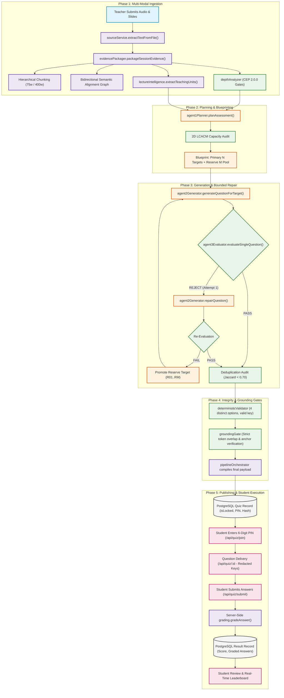
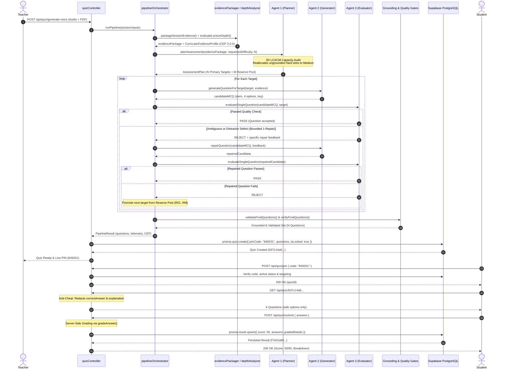

# KMIT Kahoot — Pipeline Visual Execution Flow

This document provides a concise, high-visibility visual reference for the end-to-end execution lifecycle of KMIT Kahoot.

---

## 1. End-to-End Visual Execution Flowchart

---

## 2. Detailed Multi-Agent Sequence Diagram

---

## 3. Data Transformations Between Stages

| Transition Point | Producer | Consumer | Data Payload Structure |
|:---|:---|:---|:---|
| **Stage 01 $\rightarrow$ 02** | `sourceService` | `evidencePackager` | `{ voiceTranscript: string, documentTexts: string[], codeSnippets: string }` |
| **Stage 02 $\rightarrow$ 05** | `depthAnalyzer` | `pipelineOrchestrator` | `curricularEvidenceProfile` (prerequisiteGates, observableEvidence, assessmentCapacity) |
| **Stage 05 $\rightarrow$ 06** | `pipelineOrchestrator` | `agent1Planner` | `evidencePackage` + `{ requestedCount: 6, requestedDifficulty: "Balanced" }` |
| **Stage 06 $\rightarrow$ 08** | `agent1Planner` | `agent2Generator` | `target` (`targetId`, `concept`, `intendedCognitiveOperation`, `targetDifficulty`, `evidenceAnchor`) |
| **Stage 08 $\rightarrow$ 09** | `agent2Generator` | `agent3Evaluator` | `candidate` (`questionText`, `options[4]`, `correctAnswer`, `explanation`, `metadata`) |
| **Stage 09 $\rightarrow$ 11** | `agent3Evaluator` | `groundingGate` | `passingQuestions[]` (verified MCQs + target linkages) |
| **Stage 11 $\rightarrow$ 12** | `pipelineOrchestrator` | `quizController` | `pipelineResult` (`questions[]`, `difficultyReport`, `capacityDeficitReport`, `trace`) |
| **Stage 12 $\rightarrow$ 15** | `quizController` | `prisma.result` | `Result` record (`score`, `totalQuestions`, `answers[]`, `status: "completed"`) |
