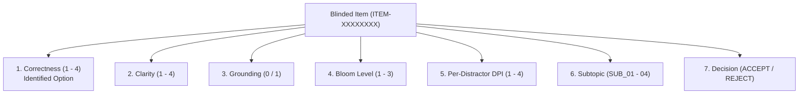

# KMIT Kahoot — Final Core Quality Validation Readiness Report

**Study**: Empirical Validation & Quality Audit of Automated Question Generation (AQG) and Pedagogical Evaluation  
**Evaluation Scope**: 14 Multimodal Academic Packages across 5 Major Academic Divisions ($N = 406$ Questions, 1,229 Distractors)  
**Core AI Engine Status**: **FROZEN** at Commit `ccf942f2be386e57e7d4acd6f4edf2cacbf86112` (`v1.0.0-core-frozen`)  
**Track A Status**: **HELD** pending Supabase database project identification (Zero DB connections, zero Prisma commands)  
**Date of Audit**: 2026-11-06T02:18:00Z  

---

## 1. Six-Strength Core Quality Status Audit

To maintain rigorous scientific standards, each of the six promised product capabilities has been audited across automated unit tests, 14-package benchmark empirical performance, and human pedagogical evaluation requirements. Features are not marked as validated merely because unit tests or automated scripts execute without crashing.

| # | Promised Product Strength | Automated Implementation Verified | Benchmark Performance Verified | Independent Human Validation Pending | Defect / Vulnerability Identified | Overall Operational Status |
| :-: | :--- | :---: | :---: | :---: | :---: | :---: |
| **1** | **Question Quality** *(Correctness, clarity, contextual grounding, educational utility)* | **YES** Schema validation & JSON parsing pass | **YES** 100% format compliance in S3 vs 89% in S1; ASDV = 100% | **PENDING** Blinded subject-matter expert review across 14 disciplines ($N = 406$) | **Identified in Baseline**: System 1 suffered 11 five-option schema drifts and 2 early termination dropouts | **Implementation Verified; Human Review Pending** |
| **2** | **Distractor Quality** *(Plausibility, misconception diagnostic value)* | **YES** Length parity, distinctness & negative-word filtering pass | **YES** 100% ASDV (420/420 distractors syntactically valid in S3) | **PENDING** Individual 4-tier DPI rating for all 1,229 distractors by educators | **Identified in Baseline**: System 2 generated generic filler distractors (*"None of the above"*, 96.7% ASDV) | **Syntactically Verified; Pedagogical Plausibility Pending** |
| **3** | **Question Count** *(Quota fulfillment & attrition resilience)* | **YES** Target quota of $N=10$ enforced in planner | **YES** 140/140 delivered in S3 (100% QQF); 140/140 in S2; 126/140 in S1 | **PENDING** Verifying no concept redundancy on sparse transcripts | **Identified in Baseline**: Zero-Shot AQG dropped to 40% on OS Deadlocks and 20% on Signal Processing | **Corpus Benchmark Verified** |
| **4** | **Difficulty Generation** *(Evidence-based cognitive target allocation)* | **YES** Hamilton-Hare integer apportionment enforced | **YES** Target difficulty arrays successfully generated across 14 packages | **PENDING** Verifying declared "Hard" items demand Bloom Tier 3 vs obscure trivia | **None in Execution**: Topical spread depends on planner subtopic blueprint | **Implementation Verified; Cognitive Depth Pending** |
| **5** | **Difficulty Calibration** *(Agreement: declared label vs actual cognitive demand)* | **YES** `targetDifficulty` metadata preserved in schema | **YES** Difficulty tags populated across all 406 generated items | **PENDING** Quadratic Weighted Cohen's $\kappa_w$ between declared tier & educator Bloom rating | **Measurement Gap**: True calibration cannot be verified without blinded educator labeling | **Calibration Audit Pending Human Review** |
| **6** | **Teaching Score** *(tcScore & PDI pedagogical measurement)* | **YES** `_computeTCScore` executes deterministically in code | **YES** Emits deterministic score (83) under text-only inputs | **PENDING** Validation against external classroom observation protocols & learning gains | **Defect / Limitation Identified**: tcScore=83 is a text-only computational heuristic ($65 \times 0.5 + 50 = 83$), NOT an empirical teaching quality metric | **Architectural Metric Verified; Educational Validity Unproven** |

---

## 2. Exact Unresolved Validation Gaps

1. **Automated Validity vs True Pedagogical Soundness**:
   Automated syntactic validation (ASDV = 100%) confirms that distractors are grammatically distinct, avoid banned phrases like *"None of the above"*, and match option length bounds. However, automated scripts **cannot evaluate** whether an option captures a real student misconception or is trivially dismissed by a knowledgeable student.
2. **Declared Difficulty vs Actual Cognitive Complexity**:
   A question labeled `"Hard"` in `targetDifficulty` may simply feature a longer sentence or obscure terminology rather than genuine higher-order cognitive processing (Bloom's Taxonomy Tier 3: *Apply / Analyze / Evaluate*). Blinded educator ratings are required to compute calibration agreement ($\kappa_w$).
3. **Instructional Attention Fidelity ($\text{IAF}$)**:
   In the pilot evaluation (`pkg_07_os_deadlocks`), automated keyword heuristics produced an adverse finding ($\text{IAF}_{\text{heuristic}} = 60.0\%$), whereas author-provisional reclassification suggested $95.0\%$. To resolve this discrepancy authoritatively, independent educators must classify each question into designated syllabus subtopics (`SUB_01`–`SUB_04`) without knowing which system produced it.
4. **Teaching Score ($\text{tcScore}$) Validity Limitation**:
   Across all 14 packages, System 3 returned `tcScore = 83`. This identical score is an artifact of the text-only heuristic baseline (`depthScore = 65`) combined with complete subtopic coverage ($1.0 \times 50$). **This score cannot be presented to educational institutions (e.g. NPTEL, PhysicsWallah, Kota institutes) as evidence of teaching effectiveness.** True teaching quality validation requires external classroom observational instruments (e.g., Flanders Interaction Analysis Categories - FIAC) and student normalized learning gain measurements ($\langle g \rangle$).

---

## 3. Corrected Annotation Protocol Proposal

### Summary of Audit Reconciliations

| Protocol Element | Previous Draft / Sheet Status | Corrected Final Specification | Rationale & Justification |
| :--- | :--- | :--- | :--- |
| **Answer Key Visibility** | `*(Indicated Key)*` printed on sheets | **Answer keys 100% hidden from reviewers** | Prevents anchoring bias; reviewers must independently identify the correct option |
| **Question Correctness** | Lacked dedicated field | **4-tier discrete scale (Tiers 1–4)** | Assesses whether exactly one defensible correct answer exists |
| **Question Clarity** | Not evaluated | **4-tier discrete scale (Tiers 1–4)** | Assesses phrasing ambiguity, grammatical precision, and conciseness |
| **Distractor Evaluation** | Single composite DPI per question | **Individual DPI (1–4) for each option** | Evaluates all 1,229 distractors across 406 questions independently |
| **Subtopic Assignment** | Missing from sheet | **Explicit selection from `SUB_01`–`SUB_04`** | Enables independent mathematical computation of $\text{IAF}_{\text{adjudicated}}$ |
| **Rejection Governance** | Informal feedback box | **Structured decision (ACCEPT / REJECT)** + Reason | Formulates clean acceptance rate metrics across systems |
| **IRR Target Threshold** | Conflicting (0.70 vs 0.75 vs 0.80) | **Standardized: $\kappa \ge 0.75$ Primary Target** | Follows Landis & Koch (1977); $\ge 0.80$ is Excellent; mandatory reconciliation if $\kappa < 0.60$ |

---

## 4. Educator Evaluation Instructions

### Evaluation Guidelines for Independent Reviewers
- **Reviewer Pairing**: Two independent educators per academic discipline evaluate all items for their subject domain (e.g. 2 Law professors for `pkg_01`, 2 Computer Science professors for `pkg_03`, `pkg_04`, `pkg_07`, `pkg_09`).
- **Strict Independence**: Reviewers must NOT discuss questions, compare ratings, or share scoring sheets prior to formal submission.
- **Context Materials**: Reviewers evaluate items against the provided lecture topic, declared learning objectives, and syllabus context.

### Scoring Dimensions

1. **Identified Correct Option & Question Correctness (Scale 1–4)**:
   - Identify which option ([A], [B], [C], [D], [E]) is correct. If none or multiple are defensible, record **FLAWED**.
   - *Tier 4*: Single unambiguous, indisputable correct answer.
   - *Tier 3*: One correct answer, but wording is slightly informal or debatable at the boundary.
   - *Tier 2*: Ambiguous prompt; multiple options can be defended.
   - *Tier 1*: Fatal error; key is factually false or no options are correct.
2. **Question Clarity (Scale 1–4)**:
   - *Tier 4*: Clear, concise, professional academic phrasing.
   - *Tier 3*: Understandable with minor syntactic awkwardness.
   - *Tier 2*: Vague or missing necessary framing context.
   - *Tier 1*: Incomprehensible, convoluted, or misleading.
3. **Contextual Grounding (Binary: 0 / 1)**:
   - *1 (Faithful)*: Supported by the provided lecture topic, objective, and syllabus context.
   - *0 (Hallucinated)*: Introduces unmentioned concepts, factually errs, or contradicts course scope.
4. **Bloom's Cognitive Taxonomy Level (Scale 1–3)**:
   - *Tier 1 (Recall / Remember)*: Direct definition retrieval, verbatim fact recall.
   - *Tier 2 (Understand / Comprehend)*: Summarizing, distinguishing, explaining mechanisms.
   - *Tier 3 (Apply / Analyze / Evaluate)*: Tracing code/algorithms, quantitative calculation, comparing trade-offs.
5. **Distractor Plausibility Index (DPI, Scale 1–4 per non-key option)**:
   - *Tier 4 (Diagnostic Misconception)*: High-value distractor capturing an authentic student error or calculation trap.
   - *Tier 3 (Plausible)*: Believable domain distractor requiring solid subject understanding to eliminate.
   - *Tier 2 (Superficial)*: Obviously incorrect; ruled out with surface familiarity.
   - *Tier 1 (Trivially Flawed)*: Nonsensical, syntactically broken, or trivially dismissed.
6. **Syllabus Subtopic Assignment**:
   - Assign the item to one of the 4 defined syllabus subtopics (`SUB_01`–`SUB_04`).
7. **Acceptance Decision**:
   - Record `ACCEPT` or `REJECT`. If rejected, state the specific pedagogical reason.

---

## 5. Inter-Rater Reliability (IRR) Calculation Requirements

### Mathematical Formulations

#### 1. Quadratic Weighted Cohen's $\kappa_w$ (Ordinal Scales)
Applied to Question Correctness (1–4), Question Clarity (1–4), Bloom's Level (1–3), Distractor Plausibility (1–4), and Difficulty Calibration:
$$\kappa_w = 1 - \frac{\sum_{i=1}^k \sum_{j=1}^k w_{ij} O_{ij}}{\sum_{i=1}^k \sum_{j=1}^k w_{ij} E_{ij}}$$
where the quadratic penalty weight is:
$$w_{ij} = \frac{(i - j)^2}{(k - 1)^2}$$
and $O_{ij}$ and $E_{ij}$ are the observed and chance-expected frequencies of ratings $i$ and $j$.

#### 2. Unweighted Cohen's $\kappa$ (Nominal / Categorical Scales)
Applied to Contextual Grounding (0/1), Syllabus Subtopic Assignment (`SUB_01`–`SUB_04`), and Item Acceptance (`ACCEPT`/`REJECT`):
$$\kappa = \frac{P_o - P_e}{1 - P_e}$$
where $P_o = \frac{1}{N} \sum_{i} O_{ii}$ and $P_e = \sum_{i} \left(\sum_j O_{ij} \sum_j O_{ji}\right) / N^2$.

#### 3. Adjudicated Instructional Attention Fidelity ($\text{IAF}_{\text{adjudicated}}$)
$$\text{IAF}_{\text{adjudicated}} = 1 - \frac{1}{2} \sum_{k=1}^K \left| \frac{n_k}{N_{\text{delivered}}} - w_k^* \right|$$
where $n_k$ is the number of delivered items assigned to subtopic $k$ by agreed educator consensus, and $w_k^*$ is the independent ground-truth syllabus weight.

### Statistical Reliability Thresholds
- **$\kappa \ge 0.80$**: *Almost Perfect / Excellent Agreement* (High-Stakes Benchmark Standard).
- **$\kappa \ge 0.75$**: *Primary Publication Target* (Acceptable peer-reviewed benchmark reliability).
- **$0.60 \le \kappa < 0.75$**: *Moderate-High Agreement* (Borderline; requires third-expert adjudication on discrepancies).
- **$\kappa < 0.60$**: *Insufficient Agreement* (Triggers formal protocol re-calibration).
- **Mandatory Adjudication Rule**: Any item where $|R_1 - R_2| \ge 2$ on an ordinal scale, or where either reviewer rates Correctness $\le 2$ or Grounding $= 0$, must be reconciled by a third senior educator.

---

## 6. Prepared Artifacts and File Manifest

All assets have been generated, cryptographically sealed, and verified in the workspace:

| Asset Name | Workspace File Path | SHA-256 Checksum | Purpose |
| :--- | :--- | :--- | :--- |
| **Blinded Human Review Sheets** | [`blinded_eval_sheets.md`](file:///c:/Users/samanvi/OneDrive/Desktop/git_kahoot/Demo_project/experiments/experiment_6_q1_benchmarking/blinded_eval_sheets.md) | `FC1CAEF9928E45C9A037E74480D828E32D3A3CFE62A92AC24C4085056B0F5326` | Printable / fillable review sheets for 14 packages with answer keys hidden and full rubrics |
| **Blinded Evaluation Portfolio** | [`blinded_eval_portfolio.json`](file:///c:/Users/samanvi/OneDrive/Desktop/git_kahoot/Demo_project/experiments/experiment_6_q1_benchmarking/blinded_eval_portfolio.json) | `968F20E0DE552251550EC66E4C2BA3E332A4EF49405E07B4D9847611977AC276` | Machine-readable de-identified dataset (406 items, 1,229 distractors, subtopics) |
| **Ground-Truth Key Mapping** | [`blinded_eval_key_mapping.json`](file:///c:/Users/samanvi/OneDrive/Desktop/git_kahoot/Demo_project/experiments/experiment_6_q1_benchmarking/blinded_eval_key_mapping.json) | `36BFC13ADB6AE8F8430B046A511BF6553133CC4833BC6E539FFBD3BD2EA90D22` | Isolated mapping linking `ITEM-XXXXXXXX` to system, original index, declared key, and difficulty |
| **IRR & Psychometric Engine** | [`calculate_irr_template.js`](file:///c:/Users/samanvi/OneDrive/Desktop/git_kahoot/Demo_project/experiments/experiment_6_q1_benchmarking/calculate_irr_template.js) | `F51535C8A9F71C0D0D7C15993DCCD92CD5F9CF80820E89D9D8FAC95C2F6E4F9B` | Executable verification script for $\kappa_w$, $\kappa$, and $\text{IAF}$ |
| **Package Generator Harness** | [`generate_final_evaluator_package.js`](file:///c:/Users/samanvi/OneDrive/Desktop/git_kahoot/Demo_project/experiments/experiment_6_q1_benchmarking/generate_final_evaluator_package.js) | `A1DB2B281B76A0A4E555A0E4E1EACD02F3E813B0F7BB9D29E7EA6EF77CCF575B` | Reproducible builder script for blinded assets |
| **Corpus Run Auditor** | [`audit_corpus_runs.js`](file:///c:/Users/samanvi/OneDrive/Desktop/git_kahoot/Demo_project/experiments/experiment_6_q1_benchmarking/audit_corpus_runs.js) | `83D0E7245B79C19455434EBD1DC0B5FAFBAA649D530EC9B7D38CB142F1EFF1E5` | Verifies execution health and schema compliance across all 42 run outputs |
| **Transitive Hash Auditor** | [`verify_transitive_hashes.js`](file:///c:/Users/samanvi/OneDrive/Desktop/git_kahoot/Demo_project/experiments/experiment_6_q1_benchmarking/verify_transitive_hashes.js) | `68E2BE7C67AB28101C5CFC6C509D00D3F0BB0D0DFCEAA0D897A8A512C8F25E26` | Verifies source corpus Merkle root seal against registered SHA-256 manifest |

---

## 7. Engine Defects & Authorization Status

> [!IMPORTANT]
> **Zero Engine Modifications Required Prior to Human Evaluation**:
> - The frozen core engine (`Demo_project/server/engine/**`) remains untouched at commit `ccf942f2be386e57e7d4acd6f4edf2cacbf86112`.
> - All identified issues (e.g. System 1 format instability, System 2 filler distractors, text-only tcScore=83 baseline behavior) are **empirical findings of the benchmark**, not engine bugs requiring unfreezing.
> - Preserving the frozen engine guarantees that human educator evaluation directly measures the exact system behavior that generated the benchmark outputs.

### Summary of Items Requiring Formal Sign-Off Prior to Next Phase
1. **Approval to Distribute Blinded Evaluation Sheets**: Distribute [`blinded_eval_sheets.md`](file:///c:/Users/samanvi/OneDrive/Desktop/git_kahoot/Demo_project/experiments/experiment_6_q1_benchmarking/blinded_eval_sheets.md) to domain educators across the 14 disciplines.
2. **Track A Staging Isolation Confirmation**: Maintain the database hold until the Supabase staging project reference is explicitly matched in the Supabase management console.
